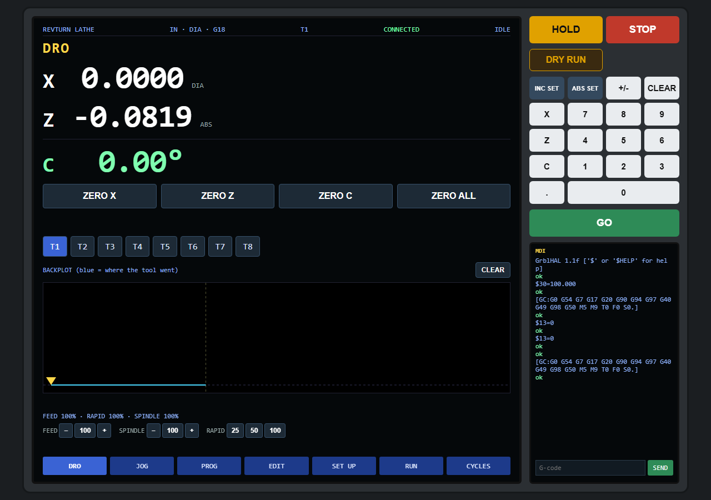
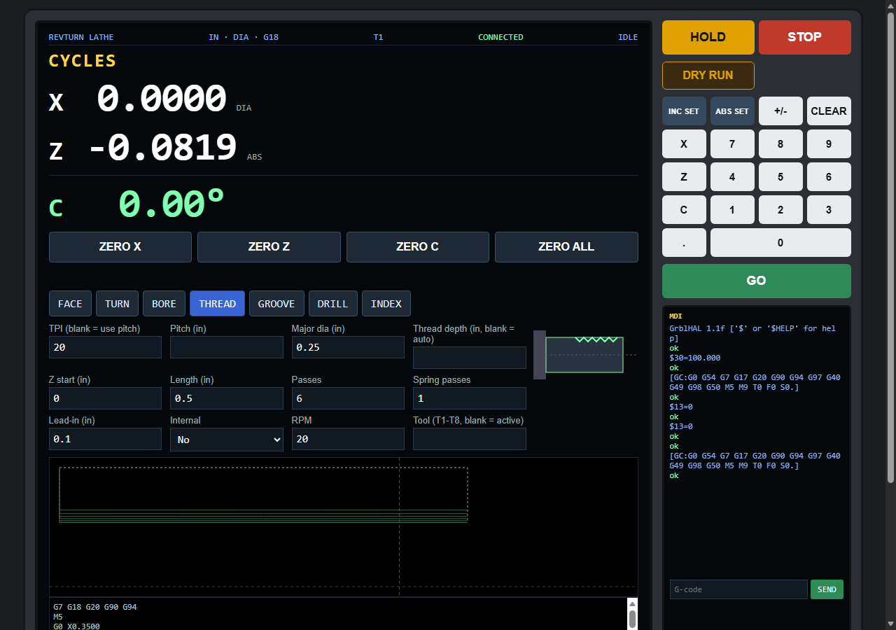
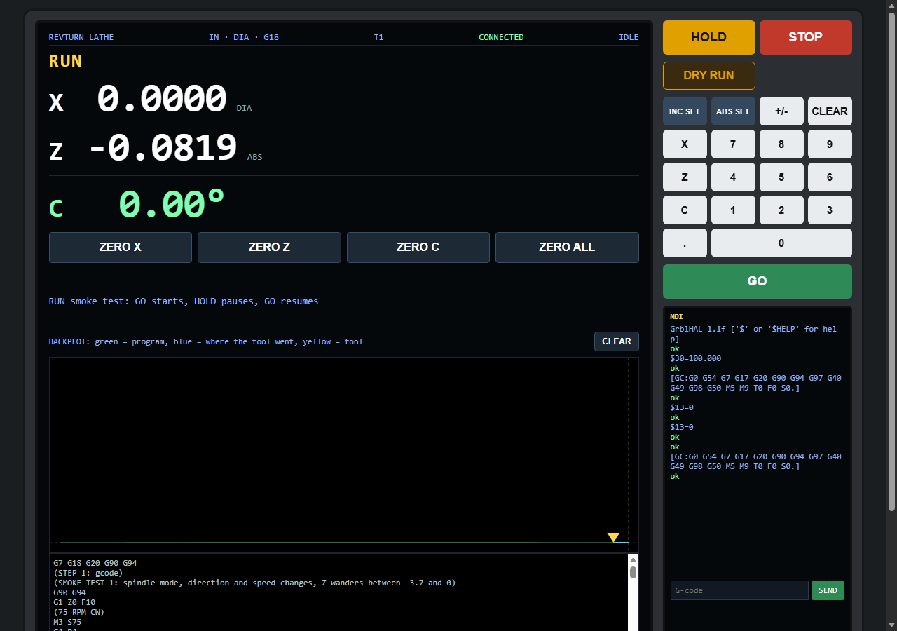
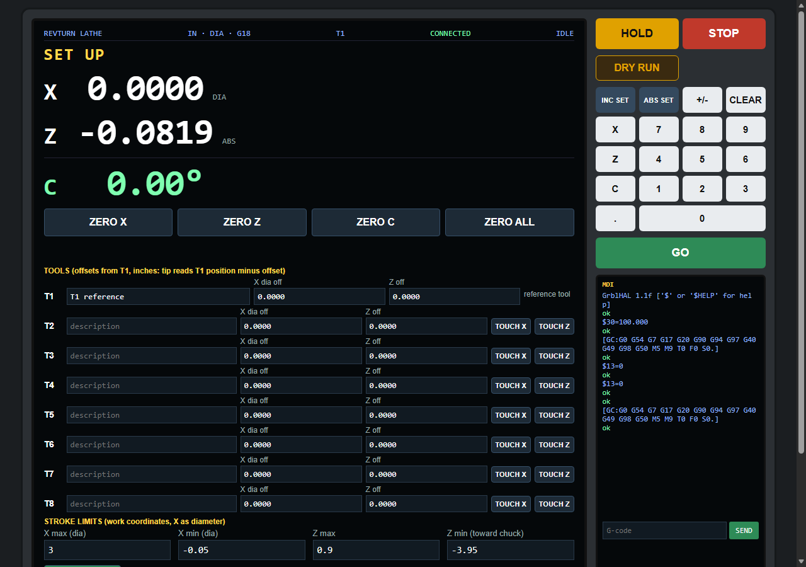
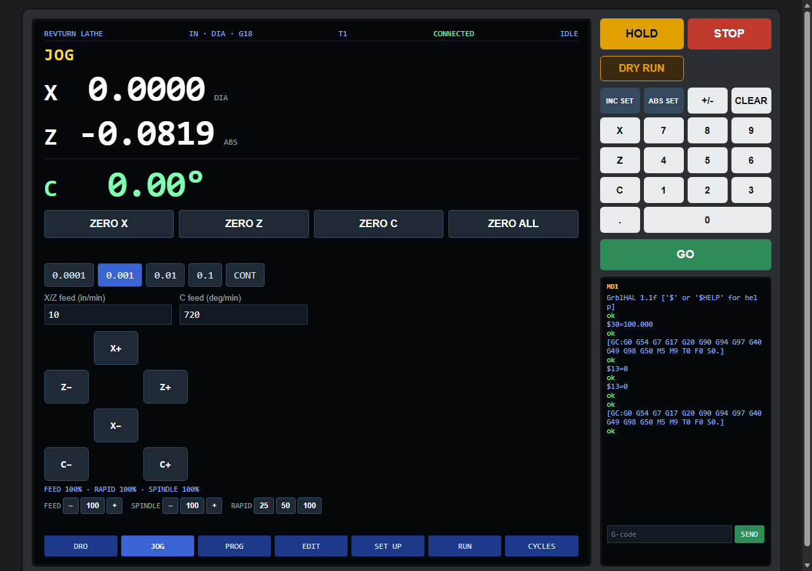
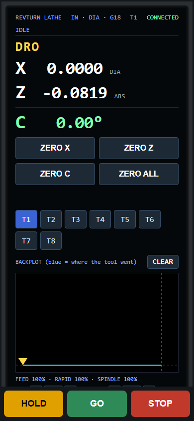
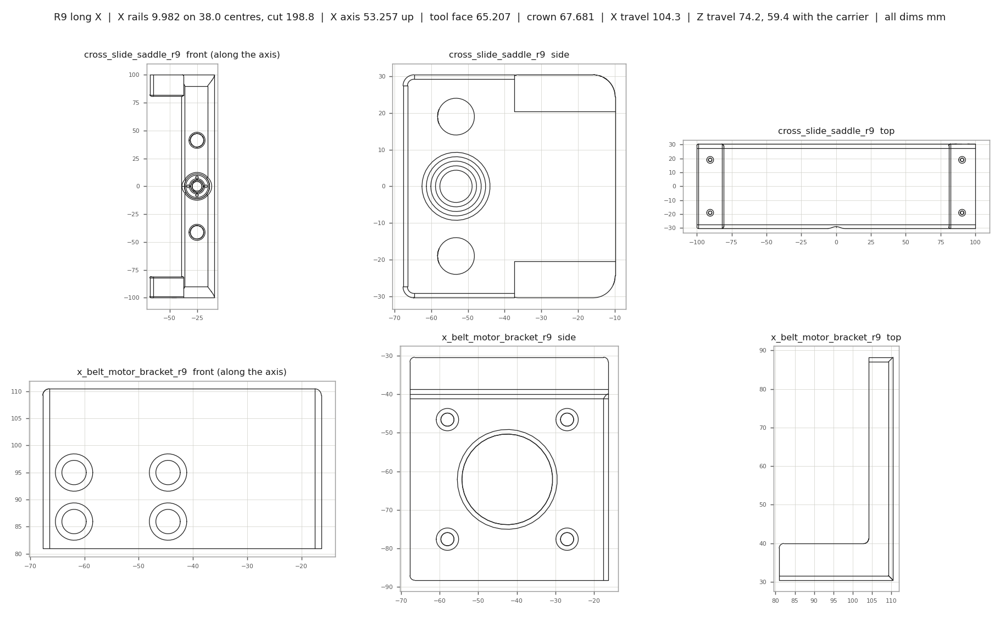

# REVTURN: a touch-screen CNC lathe controller on an ESP32

A mini CNC lathe running **grblHAL** on a $5 ESP32, with a **ProtoTRAK / Fanuc style control screen built into
the firmware**. Open `http://<lathe>/lathe.html` on a phone, a tablet by the machine, or a PC. No app, no
sender, no cloud.

From the maker of **[RotatoCAM](https://rotatocam.com)**: 4- and 3-axis CAM for DIY CNC. *Spin the stock. Read the signal.*

## ▶ Watch it run

**[First test run with all 3 motors linked together (YouTube, 10 min)](https://www.youtube.com/watch?v=2WnQ3KHcuW8)**: X, Z and the
chuck (C) in synced moves, nonstop spindle speed and direction changes, and a C-axis threading cycle.

☕ Like where this is going? **[Buy me a coffee](https://buymeacoffee.com/revjmoney)** and help keep the junk-bin lathe turning.

> **⚠ This is a junk-bin build, not a kit.** The lathe is 3D printed and put together from whatever was laying
> around the shop:
> - the rails came from a 3018 CNC upgrade and a scrapped 3D printer;
> - the headstock (spindle and chuck) is an AliExpress unit;
> - one stepper came out of a Cricut cutter and one is a StepperOnline motor.
>
> So **the STLs and every machine setting here are tuned to those exact parts.** If you build one, expect to adjust
> the printed parts to your own rails, screws, bearings and motors, and to re-calibrate:
> - steps per mm/degree, measured on your machine (see [the settings table](#machine-settings-calibrated-on-the-real-lathe));
> - driver current for your motors;
> - speeds and acceleration for whatever belts and pulleys you end up with.
>
> Treat this as a starting point to adapt, not a drop-in.

## The screen

| | |
|---|---|
|  **Conversational cycles**: face, turn (with chamfer / radius), bore, thread, groove, peck drill, **polygon (hex flats by X-C interpolation with the normal lathe tool)**, index. Fill in the form, GO previews the toolpath, GO again runs it. |  **Programs and live backplot**: chain cycles and raw g-code into a program, import Fusion lathe posts, watch the tool trace over the planned path with a live tool marker. |
|  **SET UP**: T1 to T8 tool table with touch-off (offsets from T1) and stored stroke limits (switched on and off with the LIMITS key, off by default), saved on the lathe so every screen shares them. |  **JOG**: step or continuous jog, respecting the stroke limits. |

**Machine-like controls everywhere**
- DRO in diameter (X) and Z, with C shown as **RPM in spindle mode** or **degrees in C-axis mode**.
- ZERO X / Z / C / ALL on every screen (Idle only), ABS SET / INC SET keypad, MDI console.
- HOLD and STOP always on screen. Any connected screen can HOLD or STOP the machine; extra screens show the
  live machine in VIEW ONLY.
- Feed / spindle / rapid overrides, DRY RUN (air cut, spindle off), alarm explain + RESET / UNLOCK.
- Tool changes stop the program with a "CHANGE TO T2" message; GO continues.
- Got a rotary axis on your mill too? **[RotatoCAM](https://rotatocam.com)** turns STL and STEP parts into 4-axis
  rotary toolpaths, with a grblHAL post.

 

## The machine
- X (cross slide, diameter), Z (carriage), C (chuck: a NEMA 23 that is either the **spindle** under M3/M4 or a
  **rotary C axis**), TB6600 drivers at 16x microstepping (8x on the chuck).
- ESP32 DevKit (WROOM-32), WiFi to the shop network, WebUI v3, screen served from flash.
- The lathe screen and the stock WebUI link to each other: **WEBUI** on the lathe screen, a **LATHE** tab in the WebUI
  (upload [`webui-files/`](webui-files/) to the flash file system).
- The chuck goes back to C zero the short way at the end of every program (grblHAL rotary wrap, `$538`) instead of
  unwinding hundreds of turns, the same rotary problem **[RotatoCAM](https://rotatocam.com)** deals with on 4-axis mills.

## Printed parts
The bed ends and the cross slide are 3D printed, original designs, STL + STEP in [`hardware/`](hardware/) with a parts
list, hardware list and the printing lessons learned building it.

Printing a set from these files? **[Buy me a coffee](https://buymeacoffee.com/revjmoney)** ☕ it keeps the designs coming.
Designed in FreeCAD; the rotary CAM side of the shop is **[RotatoCAM](https://rotatocam.com)**.

## Machine settings (calibrated on the real lathe)
grblHAL stores these in flash, not in the source, so after flashing a blank board send them from the MDI or a
serial terminal. Axis values are in mm and degrees (grblHAL's native units); the screen works in inches.

| Setting | Value | What it is |
|---|---|---|
| `$32` | 2 | Lathe mode (X in diameter, G7/G8) |
| `$100` | 800 | X steps/mm: **measured** (X-2 on diameter moved 0.5 in real at 400, so doubled); 8 mm T8 screw |
| `$102` | 966 | Z steps/mm: **measured** (0.99 in per commanded inch on calipers); belt to an 8 mm T8 screw |
| `$103` | 13.333 | C steps/deg: C driver at **8x** microstepping (26.667 at 16x, measured: one commanded turn = exactly one chuck turn); 20T to 120T belt |
| `$110` / `$112` | 1300 / 914.4 | X / Z max rate, mm/min (X 51 in/min; Z **36 in/min**, Rev's pick with Z at 4x microstepping) |
| `$113` | 99000 | C max rate, deg/min = **275 rpm** chuck (rpm x 360) |
| `$120` / `$122` / `$123` | 50 / 12 / 240 | X / Z accel (mm/s²), C accel (deg/s², about 2.5 s to 100 rpm) |
| `$30` | 275 | Max spindle rpm (the screen's slider tops out here; the stepper spindle is also capped by `$113`) |
| `$538` | 1 | Rotary wrap for C: `G91 G28 C0` goes the short way to the stored G28 angle and resets the C count (no unwinding hundreds of turns). The screen stores G28 on ZERO C and ends every program with it |
| `$340` | 10 | Spindle at-speed tolerance %: g-code waits for the stepper spindle to reach speed |
| `$395` | 1 | Default spindle = the stepper spindle (spindle 1 is the PWM output for a live tool) |
| `$677` | 7 | Stepper spindle options |
| `$2` / `$3` / `$5` | 5 / 1 / 7 | Step invert (TB6600 common anode), direction invert, limit invert |
| `$6` / `$14` | 1 / 64 | Probe invert and E-stop invert (bit 6), so the unwired probe (GPIO 14) and E-stop (GPIO 13) inputs read "off". Wire a normally-closed E-stop to GND, then set `$14=0` (fail-safe) |
| `$320` | revturn | Hostname: the screen is also at `http://revturn.local/lathe.html` (mDNS) |

Limits worth knowing: a TB6600 is rated to about 20 kHz of step pulses. At 16x (26.667 steps/deg) that is about 125
chuck rpm; at 8x (13.333) about 250. On this lathe the chuck runs 275 fine at 8x (a little over the driver's rating, so 4x is the fallback if it ever skips).
Past that the NEMA 23 (6:1, so 1200 motor rpm at 200 chuck rpm) runs out of torque before the driver runs out of steps;
go to 4x (6.667) or a 48 V driver like a DM542 for more.

## Branches
- `revturn-lathe` (default): the lathe build. Build with `pio run -e revturn_lathe` (ESP-IDF 4.4).
- `main`: stock grblHAL ESP32 (0b2d3e1) with every submodule flattened in at its pinned commit, so the
  difference between the two branches is exactly what this build changes.

## Changes from stock grblHAL
| Area | File | Why |
|---|---|---|
| **Crash fix** | `main/driver.c`, `main/timers.c` | The stepper-spindle step timer ISR is registered IRAM-safe but called functions in flash (`stepperOutputStep`, `timerStart/Stop`, `enable/disable_irq`). A spindle step landing during any flash read (page load, program file read, settings write) crashed the CPU. Now all IRAM_ATTR. |
| Crash handling | `sdkconfig.revturn_lathe` | Panic prints and reboots instead of halting, so a crash never leaves a silent, frozen machine. |
| WiFi | `main/wifi.c` | Stock never rejoined the network after a drop (credentials wiped, retry commented out). Now retries with 1 s to 30 s backoff, closes sockets once per outage, reboots after 15 min offline only when Idle. |
| Stepper spindle | `main/spindle/stepper.c`, `main/grbl/stepper2.c` | Rotary-mode accel / max rate units; direction-change wait yields instead of spinning. |
| Spindle speed changes | `main/grbl/stepper2.c`, `main/grbl/stepper2.h` | Speed set, start and stop now change the step profile with interrupts held off, so the step ISR never sees it half written. Lowering the speed while the spindle is still ramping up now keeps ramping to the new speed (it used to start a deceleration aimed behind the ramp). |
| Multi-screen | `main/networking/websocketd.c/.h` | Output copied to every WebUI client; non-owners may send reset / feed hold / jog cancel / status. |
| Pendant guest | `main/networking/websocketd.c` | A client that connects with `revturn-guest` never takes control from a screen (it does when no client has the stream). Guests may also send cycle start, single block, optional stop and the feed / rapid / spindle overrides (handle-driven program stepping), and whole jog (`$J=`), zero/set (`G10 L20 P0`), spindle (`M3`/`M4`/`M5`/`S`) and query (`$G`, `$#`, `$30`) lines while the lathe is Idle or jogging and the screen has nothing half-sent. |
| Build options | `main/CMakeLists.txt`, `main/boards/my_machine_map.h`, `main/grbl/gcode.c` | g-code expressions (`#` variables, `[math]`, SIN/COS/SQRT..., O-word loops and subroutines, `G65 P6`), jerk-limited motion, acceleration profiles, backlash compensation, tool nose radius comp (G41/G42, parenthesis fix for `-Werror`), mDNS, probe and E-stop inputs. **Turning these on resets all stored settings**: write your settings down first. |
| WebUI server | `main/webui/server.c` | Reports the STA IP, serves the embedded `lathe.html.gz`, broadcasts the controlling client. |
| Machine | `main/my_machine.h`, `main/boards/my_machine_map.h`, `platformio.ini`, `main/CMakeLists.txt` | Lathe pin map, PWM spindle 1, WebUI v3, LittleFS, embedded screen. |

The screen itself (plain JS, 283 tests) lives in a separate repo; its built, gzipped page is
`main/embedded/lathe.html.gz`.

## Credits and licenses
- **Firmware:** [grblHAL](https://github.com/grblHAL) by Terje Io and contributors, GPL v3 (see `README-grblHAL.md`
  and `COPYING`). The REVTURN changes are under the same license.
- **Printed parts** (`hardware/`): STL, STEP and drawings by Rev. J. Money, licensed
  [CC BY-SA 4.0](https://creativecommons.org/licenses/by-sa/4.0/). Remix them, print them, sell parts if you like;
  credit the original and share your changes under the same license. See [`hardware/LICENSE.md`](hardware/LICENSE.md).

## Support
If REVTURN helped you or you just like watching junk turn into a lathe, you can
**[buy me a coffee](https://buymeacoffee.com/revjmoney)**, or check out my CAM software
**[RotatoCAM](https://rotatocam.com)** (free Community Edition on GitHub:
[revjmoney/RotatoCAM](https://github.com/revjmoney/RotatoCAM)). Thank you!

