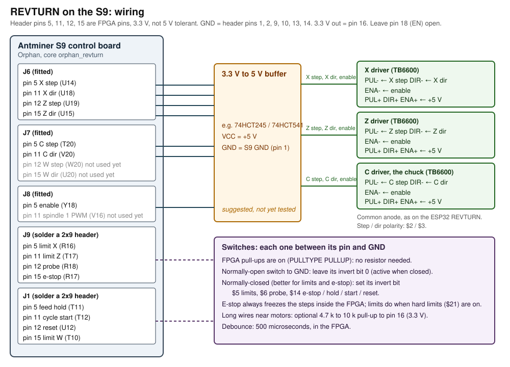

# REVTURN on the Antminer S9 (Linux + FPGA build)

A second way to run the REVTURN lathe firmware: instead of an ESP32, an **Antminer S9 control board** running
[Orphan](https://github.com/revjmoney/orphan) (its free Linux + FPGA firmware). The grblHAL core is the same one the ESP32
build uses (`main/grbl`), built as a Linux program, `revturnd`. The step pulses come from the S9's FPGA, which plays
back grblHAL's own step timing with 10 ns resolution.

You get the same REVTURN lathe screen, the same grblHAL settings and the same telnet stream for gSender or ioSender.

> **Status (2026-11-22): bench tested on an S9 board, not yet run on the real lathe.** Everything in "Tested" below
> was checked on hardware with a logic-level test (FPGA step counters), not with motors. Wire it on the bench first,
> motors unloaded, and check every axis direction and every switch before it drives the lathe.

by JMSCNC, makers of RotatoCAM. [Rev. J. Money - 2026]. GPL-3.0-or-later, like grblHAL.

## How it is split

| Part | Runs on | Job |
|---|---|---|
| grblHAL core: parser, planner, segment prep, settings, spindle logic | ARM (Linux), `revturnd` | unchanged grblHAL C from `main/grbl` |
| the step "interrupt" | FPGA, `fpga/revturn_stepgen.v` | a real-time thread runs grblHAL's step interrupt and queues each tick (step bits, dir bits, delay) in a 2048-tick FPGA queue; the FPGA plays them back at a 10 MHz step timer |
| C spindle (M3 / M4 / M5) | FPGA, a ramped step generator (NCO) | spins the C stepper at the commanded rpm, ramped by the C acceleration; on M5 the steps it made are added back to the C position |
| inputs | FPGA | synchronized and debounced (500 µs); the e-stop, and the limits when hard limits are on, freeze the steps **in the FPGA** with no software in the loop |
| lathe screen, files, `revturn-s9.local` | ARM, `revturn_web.py` + `orphan/main.py` | serves the REVTURN screen, the file API and the WebSocket the screen uses, like the ESP32 does |

Axis map: grblHAL X, Y, Z, C (Y unused) go to FPGA outputs X, Z, C. The FPGA has a fourth output pair for the W
(tailstock) axis; revturnd does not drive it yet.

## What you need

- An Antminer S9 control board (Xilinx Zynq XC7Z010), 12 V on its 6-pin PCIe connector.
- Orphan on its SD card, network cable plugged in.
- Stepper drivers with 5 V step / dir / enable inputs (the REVTURN lathe uses three TB6600s), and a 3.3 V to 5 V
  buffer (see wiring).
- For the inputs on J9 and J1 (and the W enable on J2): a 2 x 9, 2.54 mm pin header soldered into each (stock S9
  boards only have J6, J7, J8 fitted).

## Install

On the S9 (as root, from a clone of this repo):

```sh
apt install build-essential     # once, if gcc is missing
sh s9/install.sh                # builds revturnd from main/grbl + s9/driver.c, installs the Orphan core
ardzy load orphan_revturn       # programs the FPGA and starts it (add --default to start it at every boot)
```

Then:

- Screen: **http://revturn-s9.local:8000/lathe.html** (or `http://<board IP>:8000/lathe.html`).
- gSender / ioSender: connect by **Network (Telnet)** to `revturn-s9.local`, port **23**.
- Files you upload from the screen are kept in `/var/lib/revturn/files`; settings (`$$`) in
  `/var/lib/revturn/settings.bin`.

The board keeps its own name (`orphan.local`). While this core runs it also answers to `revturn-s9.local`, and to
`revturn.local` as long as no other machine has that name. The ESP32 REVTURN is also called `revturn`: when it is on
the network, the S9 leaves `revturn.local` to it, so a sender pointed at `revturn.local` never drives the wrong
machine by surprise. Use `revturn-s9.local` for the S9.

The screen in `www/lathe.html.gz` is built from `screen/` (`npm run build` there, then copy `screen/dist/lathe.html.gz`).

## Wiring

Every FPGA pin below comes from `fpga/pins.xdc`; the header pin numbers and the FPGA pin of each header pin come
from Orphan's S9 pin map ([docs/pinmap.md](https://github.com/revjmoney/orphan/blob/main/docs/pinmap.md), cross-checked against Ardzy's tested pin table).

Every S9 hashboard header J1 to J9 has the same layout:

| Header pin | What |
|---|---|
| 5, 11, 12, 15 | FPGA I/O, 3.3 V, **not 5 V tolerant**, no protection, no pull-ups on the board |
| 16 | 3.3 V out (small loads only) |
| 18 | EN, driven by the ARM side: leave it unconnected |
| 1, 2, 9, 10, 13, 14 | GND |

Check pin 1 with a meter (GND on pins 1 and 2) before the first cable.

### Outputs (3.3 V)

| Signal | Header pin | FPGA pin |
|---|---|---|
| X step | J6 pin 5 | U14 |
| X dir | J6 pin 11 | U18 |
| Z step | J6 pin 12 | U19 |
| Z dir | J6 pin 15 | U15 |
| C step | J7 pin 5 | T20 |
| C dir | J7 pin 11 | V20 |
| W step (not driven yet) | J7 pin 12 | W20 |
| W dir (not driven yet) | J7 pin 15 | U20 |
| X enable | J8 pin 5 | Y18 |
| Z enable | J8 pin 12 | W16 |
| C enable | J8 pin 15 | Y19 |
| W enable (on while any axis is on) | J2 pin 5 (solder a header on J2) | R19 |
| spindle 1 PWM (in the FPGA, not driven by revturnd yet) | J8 pin 11 | V16 |

### Inputs (switch to GND)

The FPGA's internal pull-ups are on for these pins (`PULLTYPE PULLUP`), so a switch to GND works with no other
parts. For long wires near motors, an extra 4.7 k to 10 k pull-up to pin 16 (3.3 V) makes them less noise prone
(suggestion, not tested).

| Signal | Header pin | FPGA pin |
|---|---|---|
| limit X | J9 pin 5 | R16 |
| limit Z | J9 pin 11 | T17 |
| probe | J9 pin 12 | R18 |
| e-stop | J9 pin 15 | R17 |
| feed hold | J1 pin 5 | T11 |
| cycle start | J1 pin 11 | T12 |
| reset | J1 pin 12 | U12 |
| limit W | J1 pin 15 | T10 |

Polarity: with all invert settings at 0, an input is **active when it is pulled to GND** (a normally-open switch to
GND). For a normally-closed switch (safer for limits and the e-stop: a broken wire trips it) set that input's
invert bit: `$5` limits, `$6` probe, `$14` control inputs (e-stop, hold, start, reset). This differs from the ESP32
build, where `$5 = 7` matches its wiring: on the S9, start from 0 and set bits for NC switches.

### Diagram



### To the drivers

The S9 pins are 3.3 V and drive nothing heavy. Put a 5 V powered buffer between the S9 and the drivers, for example
a 74HCT245 or 74HCT541 (HCT parts accept 3.3 V as a logic high when powered from 5 V). Its GND must join the S9 GND
(header pin 1).

How the ESP32 REVTURN lathe is wired today (from its build notes): three TB6600 drivers, X and Z step signals
active low (TB6600 common anode: PUL+ and DIR+ to +5 V, the controller pulls PUL- and DIR-), and the enable (disable)
line, active low, wired to the **Z driver only**. Its settings: `$2=5 $3=1 $4=0`.

The S9 build has **one enable pin per driver** (X, Z, C, W), so every driver's ENA can be wired: ENA+ to +5 V, ENA-
to that axis' enable through the buffer. `$4` sets each axis' enable polarity on its own (W follows X's bit), and
with `$37` grblHAL can keep some motors powered while others switch off. The C driver stays enabled while the
spindle (M3 / M4) runs it. Wired like the ESP32 lathe, the same `$2 $3 $4` apply. Check the input current your driver needs against the buffer's output
rating. If an axis moves the wrong way, flip its `$3` bit; if it steps on the wrong edge, its `$2` bit.

**Not yet tested on the S9:** the buffer stage and real drivers and motors. The parts above are a suggestion.

## Tested (2026-11-22, on an S9, FPGA step counters, no motors)

- FPGA tick playback against a Python copy of grblHAL's Bresenham: exact over 20,000 ticks; the older segment mode
  also exact (`fpga/stepgen_test.py`).
- 40 random X / Z / C moves through revturnd: the FPGA step counts equal grblHAL's MPos times steps per unit, exactly.
- M3 S60: the C spindle ramps to the commanded rate; after M5 the C position is exact (1,770,458 steps).
- Per-axis enables (X, Z, C, W), each on its own pin: all on while moving, `$37` keeps only the chosen ones on at
  idle, C switches on for M3, `$4` flips one axis' polarity (FPGA registers, 2026-11-22).
- Inputs, invert, debounce, e-stop / hard-limit freeze in the FPGA, probe position latch, PWM and NCO registers.
- The lathe screen from revturn.local in Chrome: connects, jogs X and C, runs a file (`$F=`) with live progress (the
  file was uploaded with the same `/files` API from a script, not from the screen's upload button).
- Name: answers revturn-s9.local, and gives revturn.local back when another machine announces it (simulated).
- `$I`, `$$` (94 settings), `$RTC`, status reports.

## Not done yet

- W (tailstock) axis in revturnd (the FPGA output is there).
- Spindle 1 (PWM router) in revturnd (the FPGA PWM is there).
- G38 probing that uses the FPGA's position latch (today the probe input is read live; G38 is untested).
- Threading with spindle sync (G33 / G76) has not been tried on this build.

## Files

| File | What |
|---|---|
| `driver.c`, `Makefile` | revturnd: grblHAL's HAL for the S9 (FPGA registers, real-time step thread, inputs, C spindle, telnet, settings) |
| `revturn_web.py` | the screen's server: page, `/files` API, WebSocket on port 81, `$F=` file runs |
| `www/lathe.html.gz` | the built REVTURN screen |
| `orphan/main.py`, `orphan/project.json` | the Orphan core: starts revturnd and the screen, answers `revturn-s9.local` (and `revturn.local` when free) |
| `fpga/` | the FPGA design (`top.v`, `revturn_stepgen.v`, `orphan_fan.v`, `pins.xdc`), the built bitstream, and the hardware test |
| `install.sh` | build + install on the board |
